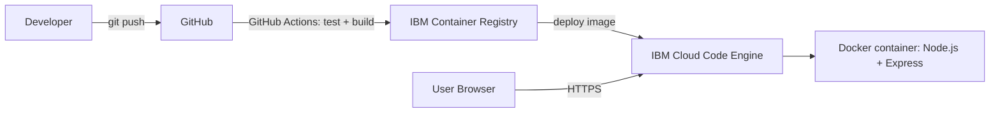

# Dockerized Web App Deployment on IBM Cloud

A simple Node.js (Express) web application, containerized using **Docker**, and ready to be deployed on **IBM Cloud** (Code Engine or Kubernetes Service).

## 📌 Project Overview

This project demonstrates:
- Building a lightweight web app with Node.js + Express
- Containerizing the app using Docker
- Pushing the Docker image to **IBM Cloud Container Registry**
- Deploying the containerized app on **IBM Cloud Code Engine**

## 🗂️ Project Structure

```
dockerized-webapp-ibm-cloud/
├── app.js               # Express app (routes, middleware)
├── server.js            # Starts server + graceful shutdown
├── package.json
├── Dockerfile           # Multi-stage, non-root, healthcheck
├── docker-compose.yml
├── .dockerignore
├── public/index.html    # Live dashboard frontend
├── tests/app.test.js    # Jest + Supertest tests
├── .github/workflows/deploy.yml   # CI/CD pipeline
└── README.md
```

## 🏗️ Architecture



## ✨ Features
- Live dashboard (hostname, uptime, memory, visitors, health status, dark/light theme)
- Security headers (`helmet`) and request logging (`morgan`)
- Multi-stage Dockerfile, non-root user, Docker `HEALTHCHECK`
- Graceful shutdown on `SIGTERM`
- Automated tests (Jest + Supertest)
- CI/CD with GitHub Actions to IBM Cloud Code Engine
- `docker-compose` for one-command local run

## 🧪 Run Tests
```bash
npm install
npm test
```

## 🚀 Run Locally (without Docker)

```bash
npm install
npm start
```

App will run at: `http://localhost:3000`

## 🐳 Run with Docker (Locally)

1. **Build the Docker image**
   ```bash
   docker build -t dockerized-webapp .
   ```

2. **Run the container**
   ```bash
   docker run -p 3000:3000 dockerized-webapp
   ```

3. Open browser at `http://localhost:3000`

Or with Compose: `docker compose up --build`

## ☁️ Deploy on IBM Cloud

### Prerequisites
- [IBM Cloud account](https://cloud.ibm.com/registration) (free tier works)
- [IBM Cloud CLI](https://cloud.ibm.com/docs/cli) installed
- Docker installed locally

### Step 1: Login to IBM Cloud CLI
```bash
ibmcloud login
ibmcloud target -g <your-resource-group>
```

### Step 2: Install Container Registry plugin
```bash
ibmcloud plugin install container-registry
```

### Step 3: Create a namespace in IBM Cloud Container Registry
```bash
ibmcloud cr login
ibmcloud cr namespace-add <your-namespace>
```

### Step 4: Build and tag the Docker image for IBM Cloud
```bash
docker build -t us.icr.io/<your-namespace>/dockerized-webapp:1.0 .
```

### Step 5: Push image to IBM Cloud Container Registry
```bash
docker push us.icr.io/<your-namespace>/dockerized-webapp:1.0
```

### Step 6: Deploy on IBM Cloud Code Engine

```bash
ibmcloud ce project create --name dockerized-webapp-project
ibmcloud ce project select --name dockerized-webapp-project

ibmcloud ce application create \
  --name dockerized-webapp \
  --image us.icr.io/<your-namespace>/dockerized-webapp:1.0 \
  --registry-secret icr-secret \
  --port 3000
```

### Step 7: Get the public URL
```bash
ibmcloud ce application get --name dockerized-webapp
```

IBM Cloud will give you a public HTTPS URL where the app is live.

### Step 8 (optional): Auto-scaling demo
```bash
ibmcloud ce application update --name dockerized-webapp --min-scale 1 --max-scale 5
```

### CI/CD (GitHub Actions)
Add these repository secrets: `IBM_CLOUD_API_KEY`, `IBM_RESOURCE_GROUP`, `ICR_NAMESPACE`, `CE_PROJECT`.
Every push to `main` runs tests, builds the image, pushes it to ICR and updates the Code Engine app.

## 🔍 API Endpoints

| Route         | Description                          |
|---------------|---------------------------------------|
| `/`           | Frontend home page                    |
| `/health`     | Health check (used by IBM Cloud probes) |
| `/api/info`   | Returns JSON app info + hostname      |
| `/api/visit`  | GET = visitor count, POST = increment |

## 🛠️ Tech Stack
- Node.js + Express
- Docker
- IBM Cloud Container Registry
- IBM Cloud Code Engine

## 📄 License
MIT

## ⚠️ Challenges Faced
_(Apne experience se likho: registry login errors, port mapping, image size, etc.)_

## 🔮 Future Scope
- Persistent database (IBM Cloudant / PostgreSQL) instead of in-memory counter
- Monitoring with IBM Cloud Monitoring / Prometheus
- Custom domain + HTTPS certificate
- Infrastructure as Code with Terraform
